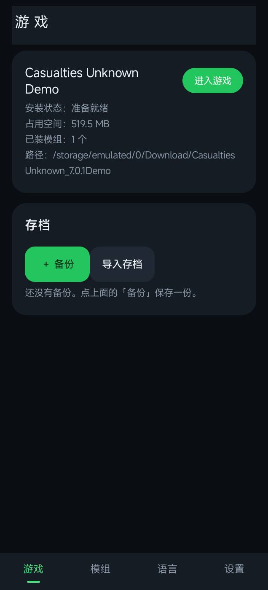
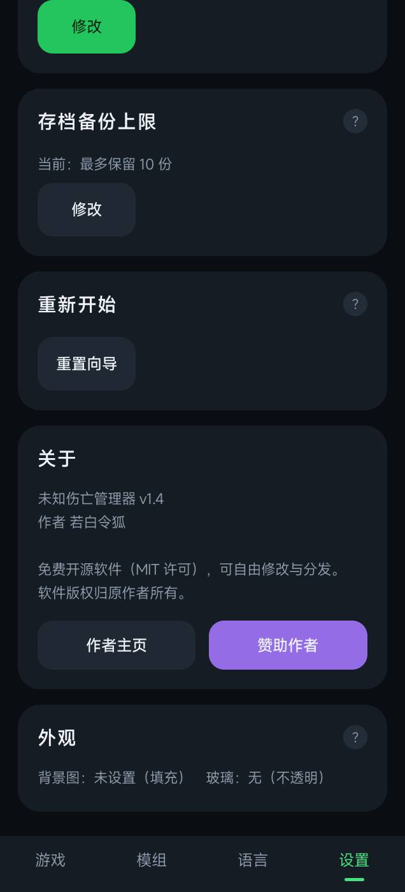

# 未知伤亡管理器 · CU Installer

面向《Casualties Unknown》的 Android 工具：把游戏安装、BepInEx 模组、语言包、存档备份和外观
设置集中到一个应用里。



## 功能

| 模块 | 说明 |
|---|---|
| 安装游戏 | 选择游戏压缩包自动解压，或直接指定已有游戏目录 |
| 游戏检测 | 自动扫描 Download、Documents、Games、存储根目录与外置 SD |
| BepInEx | 一键安装；扫描 `plugins/`，开关模组只需点一下 |
| 语言包 | 扫描 `CasualtiesUnknown_Data/Lang/*.json`，显示词条数量 |
| 存档 | `save.sv` 备份、恢复、导入导出，支持备注 |
| 游戏实例 | 多份游戏目录共存，一键切换 |
| 外观 | 8 种主题色、自定义背景、7 种玻璃样式 |
| 更新与诊断 | 检查 GitHub Release；一键导出设备信息与日志 |



## 系统要求

- Android 8.0（API 28）及以上
- 「所有文件访问」权限（读写游戏目录）
- 游戏本体需自行准备，本项目不附带

## 安装

从 [Releases](https://github.com/ss2295981866/cu-installer/releases) 下载最新 APK 安装即可。

> 不同签名的 APK 不能互相覆盖安装；自行构建时请使用同一把密钥，或先卸载旧版。

## 从源码构建

依赖：JDK 17+、R8（d8）、`zipalign`、`apksigner`、`python3`，以及 Android SDK 的
`android.jar`（API 30）。

```bash
# 1. 生成签名（仓库不包含密钥）
keytool -genkeypair -keystore build/release.jks -alias cuinstaller \
  -keyalg RSA -keysize 2048 -validity 10000 \
  -storepass changeit -keypass changeit -dname "CN=CuInstaller"

# 2. 构建
ANDROID_JAR=$HOME/android-platforms/android-30/android.jar \
R8_JAR=$HOME/r8.jar \
KS=build/release.jks KSPASS=changeit \
bash build/build-java.sh
# 产物：build/out/cuinstaller.apk
```

`targetSdk ≥ 30` 要求 `resources.arsc` 未压缩且 4 字节对齐，脚本中已先 `zipalign` 再签名。

## 项目结构

```
base/                 资源与 AndroidManifest（来自发布 APK，不含 dex / 签名）
build/build-java.sh   javac → d8 → 重打包 → zipalign → 签名
build/repack.py       资源 + classes.dex 重新打包
docs/                 截图
libs/                 第三方依赖（junrar 7.5.5、slf4j-api 1.7.36）
src/java/             应用 Java 源码
```

`src/java` 为完整可编译源码；资源与清单保留在 `base/` 中，构建时与编译产物一起打包。

## 常见问题

**为什么 APK 里没有游戏？**
游戏有版权且体积较大，仓库只提供工具。游戏请自备，解压时放进 `Download/` 或点「安装」手动选择。

**装好后显示「尚未安装」？**
确认 `CasualtiesUnknown.exe` 位于游戏目录，且已授予「所有文件访问」；也可在安装页点
「已安装游戏？」手动指定目录。

**支持哪些压缩格式？**
zip、tar.gz / tgz、rar。7z 会提示不支持，请先转换格式。

## 贡献

欢迎提交 Issue 或 PR，详见 [CONTRIBUTING.md](CONTRIBUTING.md)。

## 许可

代码以 **MIT** 许可发布，见 [LICENSE](LICENSE)。第三方组件见 [NOTICE.md](NOTICE.md)。

> **名称与图标**：「未知伤亡管理器 / CU Installer」的应用名称、图标与作者署名不在 MIT
> 授权范围内。可以 Fork 和二次开发，但未经许可不得在衍生分发中使用相同或近似的名称、图标，
> 或让用户误以为是官方版本。详见 [NOTICE.md](NOTICE.md)。

## 致谢

- [BepInEx](https://github.com/BepInEx/BepInEx)（LGPL-2.1）
- Winlator / 盖世游戏 等运行环境
- 原作者：若白令狐
